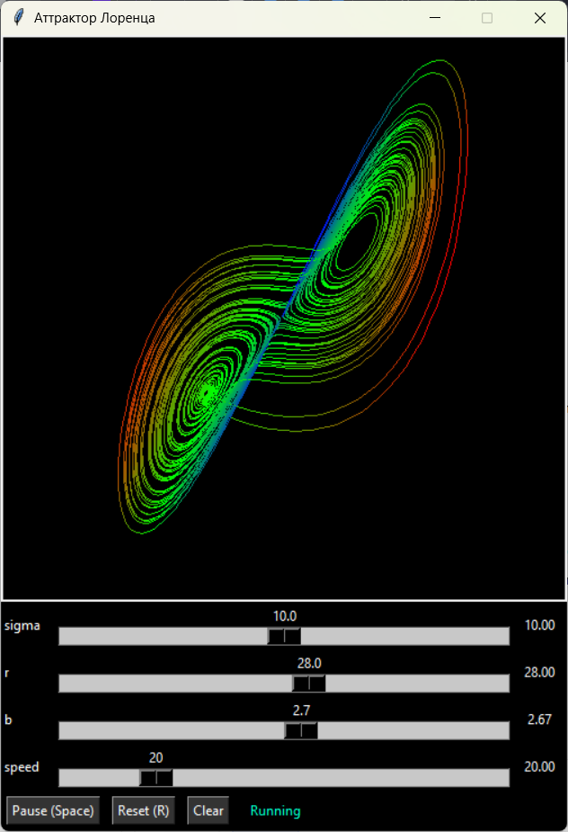
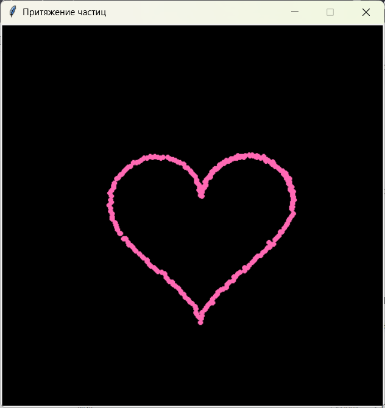

# Проекты по анимации на tkinter

**Автор:** Жакова Анна Дмитриевна

**Группа:** ПИ25-3

**Дисциплина:** Практикум по программированию

**Дата сдачи:** 28.10.2026

## Описание проектов

Репозиторий содержит две лабораторные работы по компьютерной анимации на tkinter:

1. **Лабораторная 1 — Аттрактор Лоренца.** Визуализация численного решения системы дифференциальных уравнений Лоренца методом Эйлера. Точка движется по аттрактору и оставляет цветной след, зависящий от координаты z. Реализована интерактивная регулировка параметров (sigma, r, b) и скорости анимации.

2. **Лабораторная 2 — Система частиц с притяжением.** Система частиц, притягивающихся к контуру сердца и отталкивающихся от курсора мыши. Курсор «разбрасывает» частицы, после чего они возвращаются на свои места, восстанавливая фигуру.

## Функциональные возможности

### Лабораторная 1 (Аттрактор Лоренца)

Основной функционал:

- численное интегрирование системы Лоренца методом Эйлера;
- отрисовка следа точки на холсте tkinter;
- интерактивные слайдеры параметров sigma, r, b;
- регулировка скорости анимации (число шагов за кадр);
- цветной след, зависящий от координаты z.

Дополнительный функционал:

- пауза и продолжение по клавише Space;
- сброс модели в начальное положение по клавише R;
- очистка холста без сброса модели;
- метка статуса (Running / Paused).

### Лабораторная 2 (Система частиц с притяжением)

Основной функционал:

- система из 200 частиц, притягивающихся к контуру сердца;
- отталкивание частиц от курсора мыши;
- каждая частица привязана к своей точке контура — после разбрасывания возвращается на место;
- заворачивание частиц на противоположную сторону при выходе за границы.

## Демонстрация работы

### Лабораторная 1 (Аттрактор Лоренца)



### Лабораторная 2 (Система частиц с притяжением)



## Требования к системе

- Python: 3.9 или выше;
- операционная система: Windows / macOS / Linux;
- библиотеки:
  - tkinter — входит в стандартную библиотеку Python;
  - pytest 9.1.1 — для запуска тестов.

## Установка и запуск

### 1. Клонирование репозитория

```bash
git clone https://github.com/channhoo/PPP_3sem.git
cd PPP_3sem
```

### 2. Создание и активация виртуального окружения

Windows:

```bash
python -m venv venv
venv\Scripts\activate
```

macOS/Linux:

```bash
python3 -m venv venv
source venv/bin/activate
```

### 3. Установка зависимостей

```bash
pip install -r requirements.txt
```

### 4. Запуск лабораторной 1 (Аттрактор Лоренца)

```bash
cd lab1_lorenz
python main.py
```

### 5. Запуск лабораторной 2 (Система частиц с притяжением)

```bash
cd lab2_attraction
python main.py
```

### 6. Управление

Лабораторная 1:

- слайдеры sigma, r, b — регулировка параметров системы в реальном времени;
- слайдер speed — скорость анимации;
- Space — пауза и продолжение;
- R — сброс модели и очистка холста;
- Clear — очистка холста без сброса модели.

Лабораторная 2:

- движение мыши — отталкивание частиц от курсора;
- убрать мышь с холста — частицы возвращаются на свои места.

## Структура проекта

```
PPP_3sem/
├── .gitignore
├── README.md
├── requirements.txt
├── lab1_lorenz/
│   ├── main.py
│   ├── src/
│   │   ├── __init__.py
│   │   ├── app.py
│   │   ├── models/
│   │   │   ├── __init__.py
│   │   │   └── lorenz_model.py
│   │   ├── renderers/
│   │   │   ├── __init__.py
│   │   │   └── renderer.py
│   │   └── widgets/
│   │       ├── __init__.py
│   │       └── controls.py
│   ├── tests/
│   │   ├── __init__.py
│   │   └── test_model.py
│   └── screenshots/
│       └── lorenz.png
├── lab2_attraction/
│   ├── main.py
│   ├── src/
│   │   ├── __init__.py
│   │   ├── app.py
│   │   ├── models/
│   │   │   ├── __init__.py
│   │   │   ├── particle.py
│   │   │   └── particle_system.py
│   │   └── renderers/
│   │       ├── __init__.py
│   │       └── renderer.py
│   └── screenshots/
│       └── heart.png
└── venv/
```

Назначение основных модулей:

**Лабораторная 1 (Аттрактор Лоренца):**

- `lab1_lorenz/main.py` — точка входа;
- `lab1_lorenz/src/app.py` — класс App: окно, холст, главный цикл;
- `lab1_lorenz/src/models/lorenz_model.py` — модель Лоренца (численное интегрирование);
- `lab1_lorenz/src/renderers/renderer.py` — отрисовка следа;
- `lab1_lorenz/src/widgets/controls.py` — слайдеры и кнопки;
- `lab1_lorenz/tests/test_model.py` — тесты модели.

**Лабораторная 2 (Система частиц):**

- `lab2_attraction/main.py` — точка входа;
- `lab2_attraction/src/app.py` — класс App: окно, холст, обработка мыши, главный цикл;
- `lab2_attraction/src/models/particle.py` — модель одной частицы;
- `lab2_attraction/src/models/particle_system.py` — система частиц (силы, обновление);
- `lab2_attraction/src/renderers/renderer.py` — отрисовка частиц.

Обоснование структуры: каждый проект разделён на слои по принципу разделения ответственности. Модель (`models`) содержит только математику и не зависит от tkinter, что упрощает тестирование. Рендерер (`renderers`) отвечает только за отрисовку. Виджеты (`widgets`) изолируют элементы интерфейса. Две лабораторные работы размещены в отдельных папках (`lab1_lorenz/`, `lab2_attraction/`), что позволяет запускать их независимо друг от друга и не смешивать код.

## Пример использования

Лабораторная 1:

```bash
cd lab1_lorenz
python main.py
```

Откроется окно с чёрным холстом и панелью управления. Через несколько секунд появится «бабочка» Лоренца. При изменении слайдера r форма аттрактора меняется. Space — пауза, R — сброс.

Лабораторная 2:

```bash
cd lab2_attraction
python main.py
```

Откроется окно, в котором 200 частиц собираются в форме сердца. При движении мыши частицы разлетаются от курсора, после чего возвращаются на свои места.
